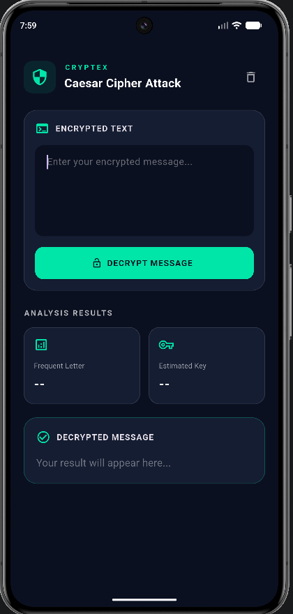

# Caesar Cipher Attack - Frequency Analysis

## Goal
Decrypt a Caesar-encrypted message without knowing the key
and without brute force.

## Method
1. Count the frequency of each letter in the ciphertext.
2. Assume the most frequent letter corresponds to "E"
   (most frequent letter in English).
3. Estimated key = (position of most frequent letter - 4) mod 26.
4. Decrypt each letter with: (position - key + 26) % 26.

## Run
flutter pub get
flutter run

## Limitation
Short messages may give a wrong key because the most frequent
letter is not always "E".

## Screenshots

